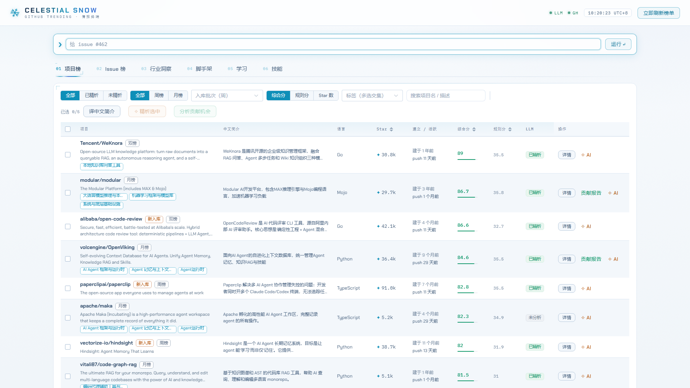
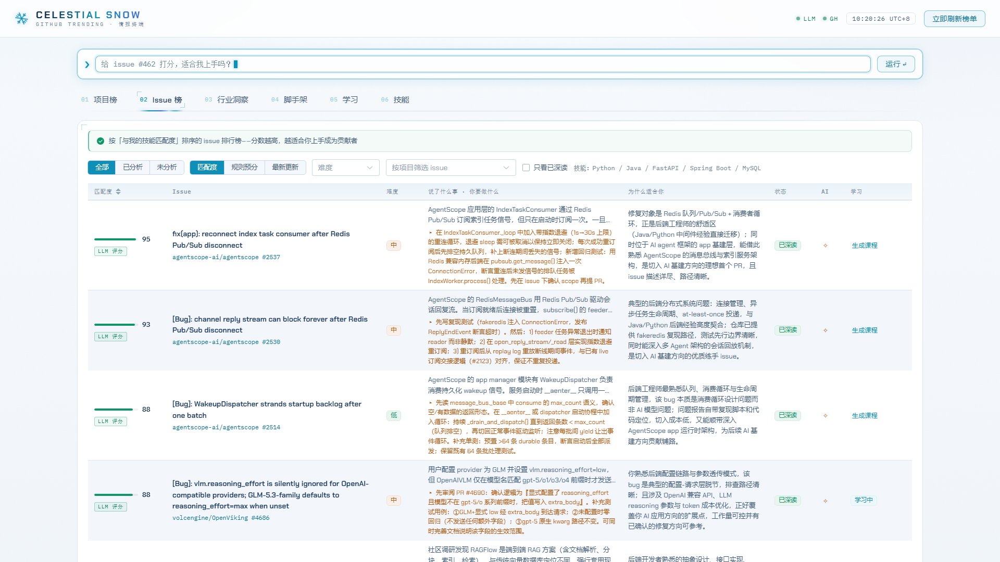
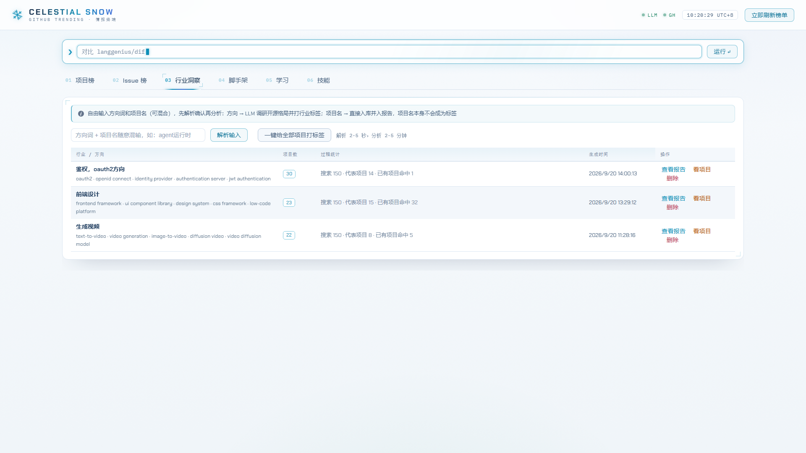
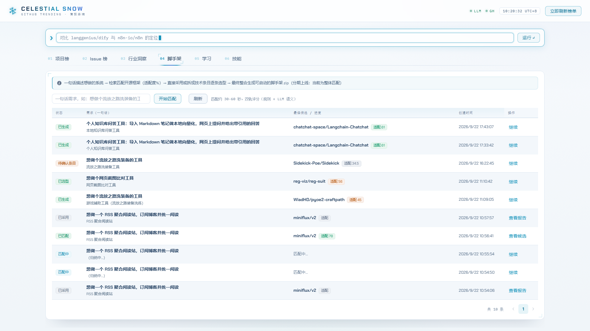
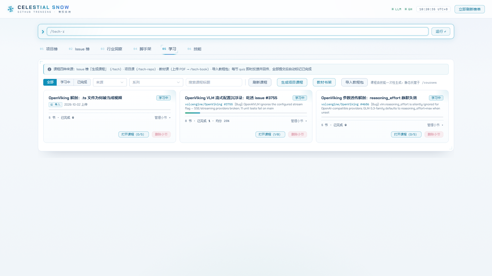
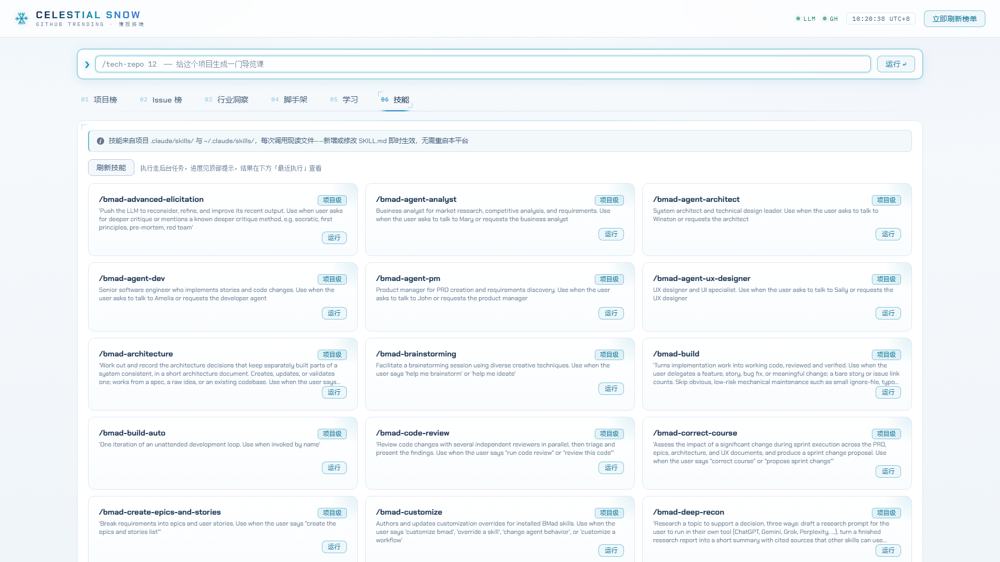

<div align="center">

# ❄️ SnowScope

**GitHub Trending 情报站 × 开源贡献导航 × AI 学习闭环**

*A self-hosted intelligence station for GitHub Trending — dual-track scoring,
issue matching, scaffold generation, and an AI-powered learning loop, all in one repo.*

[](LICENSE)
[](https://www.python.org/)
[](https://fastapi.tiangolo.com/)
[](https://vuejs.org/)

每天定时抓取 GitHub Trending → **规则 + LLM 双轨评分**筛出值得投入的项目 →
按**你的技能画像**匹配最适合上手的 issue → 生成贡献报告 →
一键产出**带测验的互动学习课程**。还能用一句话需求让 Agent 直接**生成项目脚手架**。

自部署、自掌控：FastAPI + Vue 3 + SQLite，一个仓库，开箱即用。

[快速开始](#-快速开始) · [功能总览](#-功能总览) · [工作原理](#-工作原理) · [技能扩展](#-技能扩展) · [路线图](#-路线图)

</div>

---



## 为什么做这个

刷 GitHub Trending 的常态是：**看得多，留下得少**。

- 榜单每小时都在变，没有「值得长期关注」的沉淀视角；
- 想给开源项目贡献代码，但找到「适合自己技能栈、难度合适、还没被人修掉」的 issue 全靠缘分；
- 收藏了 = 学到了？看完即忘，缺少把「发现 → 理解 → 动手」串起来的闭环。

SnowScope（应用内品牌标识为 CELESTIAL SNOW）把这条链路做成了一个**自托管的小型情报系统**：
数据自己抓、评分自己跑、画像自己配、课程自己生成，全部能力沉淀在本地 SQLite 里，越用越懂你。

## ✨ 功能总览

### 📊 项目榜 —— 双轨评分的热门项目情报

规则分（star 势能、语言生态、活跃度等）+ LLM 精析分（技术价值、与你的画像匹配度）双轨并行，
支持标签多选交集、中文简介批量翻译、按入库批次（周）回看，避免只追「本周新面孔」。

### 🎯 issue 榜 —— 给「你」的贡献机会

对入库项目的开放 issue 做 LLM 精筛：匹配度评分、难度分档，**三信号僵尸推荐治理**
（疑似已修复文本 / GitHub 已关闭 / 修复 PR 已合并的 issue 自动沉底），不浪费你的热情。



### 🧭 行业洞察 —— 一句话出一份行业地图

随手输入「agent 运行时 pi deer-flow」，LLM 自动拆出「方向词 vs 项目名」，
方向经标签库归一、项目名 GitHub 定位，串行跑出多方向分析报告：每个方向的代表项目、分类清单与综述。



### 🏗️ 脚手架 —— 从一句话需求到可下载的项目骨架

`想做个流放之路洗装备的工具` → 匹配开源底座候选（规则 + LLM 双轨适配度）→
拆技术条目逐条选型（或自研）→ Agent 生成**六件套**（README / 前端页 / docs 三件 / LICENSES）→
静态校验打包成 zip 直链下载。三层内容寻址缓存，同组合重生成秒回。



### 📚 学习闭环 —— 把情报变成课程

四种来源一键生成**带测验的互动课程**：

| 来源 | 玩法 |
|---|---|
| issue | 「吃透这个 issue」：背景、代码走读、上手路径、测验 |
| 项目 | 项目课：导览 / 架构走读 / 上手路径 |
| 教材 | 上传 PDF（扫描页自动视觉模型转录），整本精讲或按章生成系列课 |
| 导入 | 导入别处生成的教程包（zip 或单个 HTML），平台统一托管 |

课程本地学习带 quiz 进度回传，也可一键发布成纯静态副本分享。



### 🛠️ 技能宿主 —— 无头跑 Claude Code 技能

内置 Agent SDK（vendored cc-mini，in-process），平台可以无头执行任意 Claude Code 技能，
支持技能参数表单、长任务时间线、**AskUser 桥接**（任务中途向你提问，网页上作答后续跑）。
`.claude/skills/` 里的技能放进仓库即被平台识别。



## 🚀 快速开始

**前置**：Python 3.11+、Node.js 18+（构建前端）、一个 GitHub Token、一个 OpenAI 兼容的 LLM Key
（GLM Coding Plan / DeepSeek / 通义 / 本地 ollama 均可）。

```bash
git clone https://github.com/404meters-ha/snowscope.git
cd snowscope

# 1. 后端依赖
python -m venv .venv
.venv\Scripts\activate          # Windows；Linux/macOS: source .venv/bin/activate
pip install -r requirements.txt

# 2. 配置
copy .env.example .env          # Linux/macOS: cp .env.example .env
#    编辑 .env，至少填：GITHUB_TOKEN、LLM_BASE_URL、LLM_API_KEY、LLM_MODEL

# 3. 构建前端
cd frontend && npm install && npm run build && cd ..

# 4. 启动
python -m uvicorn main:app --port 8100
```

打开 <http://localhost:8100>，点右上角「立即刷新榜单」，等几分钟就有第一份数据。
之后每天 `SCHED_HOUR`（默认 8 点）自动抓取分析。

<details>
<summary><b>⚙️ 配置项说明</b>（点开）</summary>

| 变量 | 必填 | 说明 |
|---|---|---|
| `GITHUB_TOKEN` | ✅ | GitHub PAT（repo / read:user），无限流基本不可用 |
| `LLM_BASE_URL` / `LLM_API_KEY` / `LLM_MODEL` | ✅ | 任意 OpenAI 兼容端点 |
| `LLM_VISION_MODEL` | ⭕ | 视觉模型（扫描版 PDF 转录用），空则回退主模型 |
| `SEARCH_PROVIDER` / `SEARCH_API_KEY` | ⭕ | bocha / tavily / zai，空则只用 README 声明的案例（保守模式） |
| `GITHUB_PROXY` | ⭕ | 本机代理（访问 github.com 网页端 trending 用） |
| `USER_PROFILE` / `USER_SKILLS` | ⭕ | 你的背景与技能清单，评分与推荐的「主观锚点」 |
| `CANDIDATE_POOL` / `TOP_N_LLM` / `SCHED_HOUR` | ⭕ | 候选池 / LLM 精析数量 / 每日抓取时刻 |
| `BASE_PATH` | ⭕ | 子路径部署前缀（如 `/celestial-snow`），改后需重新构建前端 |
| `LOCAL_PUBLISH_DIR` / `LOCAL_PUBLISH_BASE_URL` | ⭕ | 课程发布目录与对外地址（nginx 接管时用） |

</details>

## 🧠 工作原理

```
GitHub Trending / Search API
        │  每日定时抓取（APScheduler）
        ▼
┌─────────────────────────────────────────────┐
│              SQLite（celestial.db）          │
│   repos / issues / tags / industries /       │
│   courses / tasks / scaffold_caches …        │
└─────────────────────────────────────────────┘
        ▲  规则评分 + LLM 精析（双轨）    │  课程 / 报告 / 脚手架产物
        │                                ▼
┌──────────────┐   in-process   ┌──────────────────┐
│   FastAPI    │◄──────────────►│  内置 Agent SDK   │
│ (:8100)      │                │ (vendored cc-mini)│
└──────────────┘                └──────────────────┘
        │ 静态托管                     无头执行 Claude Code 技能
        ▼                              + AskUser 桥接问答
   Vue 3 + Element Plus
```

```
app/             FastAPI 后端：api 路由 / services（抓取、评分、LLM、Agent SDK、课程）
frontend/        Vue 3 + Element Plus 前端（vite 构建）
.claude/skills/  技能家族：/tech /tech-repo /tech-book 课程生成模板与 assets
vendor/cc-mini   内置 Agent SDK（被 requirements.txt 以本地依赖安装）
doc/scaffold/    脚手架功能的设计文档与 E2E 截图
docs/screenshots README 用截图
```

## 🧩 技能扩展

课程生成不是写死的代码，而是三个**技能**（`.claude/skills/` 下的 SKILL.md + 模板）：

- `/tech` —— issue 课：吃透一个 issue 的背景、代码与上手路径
- `/tech-repo` —— 项目课：导览 / 架构走读 / 上手路径
- `/tech-book` —— 教材课：整本精讲或「第 N 章」单章模式

三者共享同一套模板与 assets，新增课程形态只需按此模式加一个技能目录；
任何其他 Claude Code 技能丢进 `.claude/skills/` 也能被平台无头执行。

## 🗺️ 路线图

- [ ] 多用户与画像隔离
- [ ] 更多情报源（Hacker News / Product Hunt / V2EX）
- [ ] 英文界面与多语言课程
- [ ] 贡献回执：学习闭环对接真实 PR 的提交与合并追踪

## 🤝 贡献

欢迎 issue 与 PR。小改动直接提，大改动建议先开 issue 对齐方向。

## 📄 许可

[MIT](LICENSE) — `vendor/cc-mini` 遵循其自带许可。

---

<div align="center">

**如果 SnowScope 帮你找到了第一个值得贡献的开源项目，欢迎给个 ⭐ 让更多人看到**

</div>
